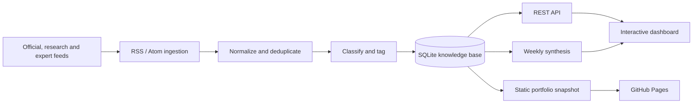

# Signal Desk · SEO Intelligence Hub

An evidence-first intelligence workspace for SEO, GEO and paid search. Signal Desk collects industry feeds, classifies and deduplicates articles, tracks source reliability, monitors search experts, and converts weekly activity into a decision-ready brief.

[Live portfolio](https://nanatan601-a11y.github.io/seo-intelligence-hub/) · [Source code](https://github.com/nanatan601-a11y/seo-intelligence-hub)

> **Portfolio deployment:** the GitHub Pages site is a read-only snapshot that demonstrates the complete interface without requiring a server. Clone the repository to run live RSS ingestion and source management.

## What it demonstrates

- Product thinking: a clear information architecture across Content, Technical, Authority and International SEO, GEO / AI Search, and SEM.
- Evidence design: T0–T4 source tiers keep official guidance distinct from research, expert analysis and social hypotheses.
- Data engineering: RSS 2.0 and Atom ingestion, URL normalization, SHA-256 deduplication, feed health isolation, historical backfill and SQLite persistence.
- Applied analysis: a dynamic weekly brief summarizes material changes, business impact, supporting sources and recommended actions—not just article counts.
- Research workflow: expert monitoring, official-update views, cross-channel search, bookmarks and an auditable source registry.
- Deployment: one codebase supports a live Python application and a static, recruiter-friendly GitHub Pages portfolio.

## Architecture



## Run locally

The backend uses only the Python standard library.

```bash
git clone https://github.com/nanatan601-a11y/seo-intelligence-hub.git
cd seo-intelligence-hub
PYTHONPYCACHEPREFIX=/tmp/seo-hub-pycache python3 server.py
```

Open <http://127.0.0.1:8765> and select **Refresh intelligence**. Local data is stored in `data/seo_hub.db` and is excluded from Git.

### Refresh feeds

```bash
./scripts/run_refresh.sh
```

Backfill paginated feed history and rerun classification for the last 90 days:

```bash
PYTHONPYCACHEPREFIX=/tmp/seo-hub-pycache python3 server.py --backfill-days 90
```

### Generate a weekly brief

The local evidence-rule synthesis needs no API key:

```bash
./scripts/run_weekly.sh
```

Optional AI synthesis uses the OpenAI Responses API:

```bash
export OPENAI_API_KEY="your-project-api-key"
export OPENAI_MODEL="gpt-6-luna"
./scripts/run_weekly.sh --ai
```

The API key is read only from the environment and is never written to the database or frontend. `OPENAI_MODEL` can override the default model.

### Rebuild the portfolio snapshot

```bash
PYTHONPYCACHEPREFIX=/tmp/seo-hub-pycache python3 scripts/build_demo_data.py
```

This writes `static/demo-data.js`. The GitHub Pages workflow deploys only the `static/` directory; no local database or credentials are published.

## Source strategy

The starter registry includes Google Search Central, Google Search documentation updates, web.dev, Google Ads, Microsoft Advertising, Ahrefs, Screaming Frog, Search Engine Land, Search Engine Journal, Search Engine Roundtable, Aleyda Solis, Barry Adams, Siege Media / Ross Hudgens, BuzzStream and Majestic.

The expert directory contains 28 specialists across technical, content, authority, international and AI-search disciplines. Stable websites and feeds are collected automatically. X profiles are used as discovery entry points and should be cross-checked against primary documentation or original data.

| Tier | Evidence standard |
|---|---|
| T0 | Official search-engine, advertising-platform or standards-body source |
| T1 | Original research, data report or reproducible experiment |
| T2 | Expert analysis or in-depth industry publication |
| T3 | Social insight or discussion lead |
| T4 | Unverified claim or secondary retelling |

## API

| Method | Route | Purpose |
|---|---|---|
| GET | `/api/dashboard` | Metrics, latest intelligence and current weekly brief |
| GET | `/api/articles` | Search and filter the knowledge base |
| PATCH | `/api/articles/{id}` | Update read and bookmark state |
| GET/POST | `/api/sources` | List or add sources |
| PATCH | `/api/sources/{id}` | Edit or enable/disable a source |
| POST | `/api/refresh` | Refresh all feeds or one selected source |
| POST | `/api/weekly` | Generate an evidence-rule or AI weekly brief |
| GET | `/api/experts` | Expert profiles and collected-article statistics |

## Responsible collection

- The current release uses public RSS/Atom feeds and does not bypass login walls or anti-bot controls on X, LinkedIn or other platforms.
- Login-gated social content should be integrated through official APIs, licensed data or another compliant route.
- Classification is intentionally transparent and rule-based, making false positives inspectable and easy to correct.
- The hosted portfolio is read-only. The live local application is designed for a single analyst and does not yet include authentication or team permissions.

## Tests

```bash
PYTHONPYCACHEPREFIX=/tmp/seo-hub-pycache python3 -m unittest discover -s tests -v
```

## License

MIT
